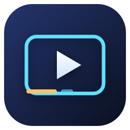
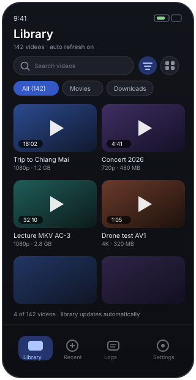
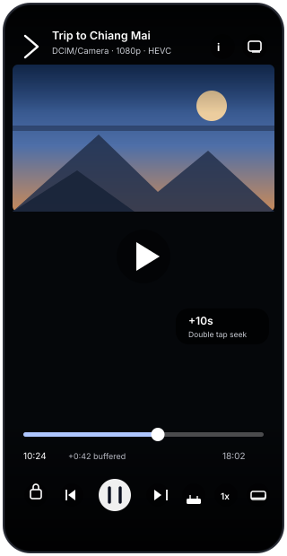
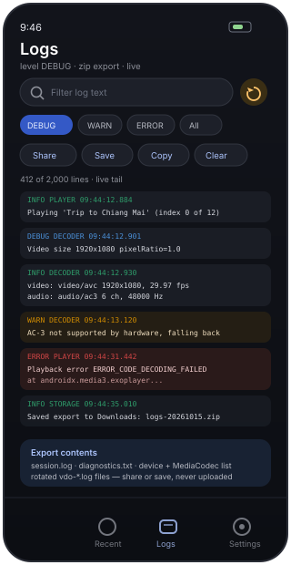

# VDO Player



An Android video player for the videos **already on your phone**: it scans your
media library, plays practically anything the hardware can throw at it, hands a
file to another phone over Wi-Fi, and keeps a detailed log you can hand to a
developer when something refuses to play.

[](https://github.com/NarDecH/Android_VDO_Player/releases/latest)
[](https://github.com/NarDecH/Android_VDO_Player/releases)
[](LICENSE)
[-green)](app/build.gradle.kts)

**Download page (GitHub Pages):** https://nardech.github.io/Android_VDO_Player/
— it reads the latest release straight from the GitHub API.

---

## สรุปภาษาไทย

แอปเล่นวิดีโอสำหรับ Android ที่เน้นสามเรื่อง

1. **เล่นไฟล์ในเครื่องได้ครอบคลุมที่สุด** — ใช้ Media3/ExoPlayer เป็นหลัก แล้วเพิ่ม
   ตัวถอดรหัส FFmpeg (ผ่าน NextLib) เป็นตัวสำรอง ไฟล์ที่ชิปในเครื่องเล่นไม่ได้
   เช่น MKV ที่มีเสียง AC-3/E-AC-3, VP9/AV1 บนเครื่องรุ่นเก่า จะถูกเล่นด้วยซอฟต์แวร์
2. **หน้าจอสวยงาม ใช้ง่าย** — Material You, ปรับธีมสว่าง/มืด, ค้นหา/เรียง/กรองตามโฟลเดอร์,
   ท่าทางลากนิ้วปรับความสว่าง–เสียง–เลื่อนเวลา, ปุ่มล็อกจอ, เร่งความเร็ว, PiP, ซับไทเทิล
3. **ระบบ log ละเอียดสำหรับดีบัก** — เก็บ log ลงไฟล์แบบหมุนเวียน (สูงสุด 10 ไฟล์ ไฟล์ละ 2 MB),
   จับ crash พร้อม stack trace, มีรายงานอุปกรณ์ + รายการ codec ของเครื่อง และกด
   **ส่ง** หรือ **บันทึกลง Downloads** เป็น .txt หรือ .zip ได้ในคลิกเดียว
4. **ส่ง-รับไฟล์ระหว่างมือถือผ่าน Wi-Fi** — แท็บ **รับ-ส่ง** เครื่องหนึ่งกด *เริ่มรับ*
   อีกเครื่องกด *ค้นหา* แล้วเจอกันเองในวง Wi-Fi เดียวกัน (หรือพิมพ์ที่อยู่เองก็ได้)
   กรอกรหัส 4 หลักที่เครื่องรับแสดงไว้ แล้วไฟล์ก็ย้ายเครื่อง วิดีโอไปอยู่ที่
   **Movies/VDO Player** และขึ้นในคลังให้เล่นต่อทันที ไม่ต้องต่อเน็ตออกนอก ไม่ต้องมีบัญชี

เมนูทั้งแอปมีสองภาษา: อังกฤษ (ค่าเริ่มต้น) และ **ไทย** เปลี่ยนได้ที่
**ตั้งค่า → ระบบ → ภาษาแอป** (Android 13 ขึ้นไป) ส่วนข้อความใน log และรายงานวินิจฉัย
ยังเป็นภาษาอังกฤษ เพื่อให้คัดลอกส่งในรายงานบั๊กได้ตรงกัน

ติดตั้ง: ดาวน์โหลด APK จาก [Releases](https://github.com/NarDecH/Android_VDO_Player/releases/latest)
(เลือก `arm64-v8a` สำหรับมือถือรุ่นใหม่ หรือใช้ `universal` ถ้าไม่แน่ใจ)

---

## Features

| | |
|---|---|
| **Library** | MediaStore scan with live updates, thumbnails, search, folder filter chips, sort by date/name/duration/size, grid or list layout |
| **Playback** | Media3 ExoPlayer, FFmpeg software fallback decoders, decoder priority switchable **while a video plays** (hardware ⇄ FFmpeg), audio track picker, playlists with next/previous, resume where you stopped, repeat off / whole queue / one video (remembered), background audio through a media notification |
| **Controls** | Tap to show controls, double tap ±seek, swipe for brightness / volume / seek with a frame preview of the target position, pinch-free zoom modes, long press for 3× speed, control lock, screen rotation, picture-in-picture |
| **Format support** | Platform hardware decoders plus FFmpeg: H.264, HEVC, VP8, VP9, AV1 (dav1d), AAC, AC-3, E-AC-3, FLAC, OPUS, Vorbis, DTS, TrueHD, MLP and more |
| **Subtitles** | Embedded text tracks, side-loaded `.srt` / `.vtt` / `.ass` picker, subtitle on/off toggle, and automatic loading of a subtitle file that sits next to the video under the same name (or a language tag, `Movie.th.srt`) |
| **Diagnostics** | Ring-buffer log with level/tag/text filters, rotating files on disk, crash capture, device + MediaCodec inventory, export as `.txt` or `.zip`, share or save to Downloads |
| **UX** | Material 3 with dynamic colour, light/dark/system themes, 1–4 column library, gesture toggle, keep-screen-on, remember brightness |
| **Transfer** | Phone-to-phone over your own Wi-Fi — or over **Wi-Fi Direct** when there is no router at all: receive mode runs a local server behind a four digit code, send mode finds receivers over mDNS or takes a typed `ip:port`, several files at a time with progress and cancel, videos land in Movies/VDO Player and appear in the library |
| **Languages** | English and Thai UI, listed in the Android 13+ per-app language picker; log lines and diagnostics stay English so they can be pasted into a bug report |

Stream details are visible while watching: tap the info button to see the exact
video/audio/subtitle formats that were selected for the current file, the decoder
chips that switch hardware ⇄ FFmpeg without leaving the video, and a **Copy full
diagnostics** button for bug reports.

## Screenshots

The images below are design mockups of the shipped layouts (see
[docs/RESEARCH.md](docs/RESEARCH.md#screenshots) for why they are vector mockups
rather than device captures).

| Library | Player | Logs |
|---|---|---|
|  |  |  |

## Install

1. Open the [download page](https://nardech.github.io/Android_VDO_Player/) or the
   [latest release](https://github.com/NarDecH/Android_VDO_Player/releases/latest).
2. Pick the APK that matches your phone:
   - `arm64-v8a` — every phone from roughly 2016 onwards (recommended)
   - `armeabi-v7a` — older 32-bit devices
   - `universal` — contains all architectures, safest if unsure, ~2× the size
3. Allow installation from unknown sources when Android asks, then open the file.

Requires Android 8.0 (API 26) or newer. The app asks for video read access on
first launch, and for local network access on Android 17 if you use the transfer
tab. Videos never leave the device on their own: the only outbound traffic is the
Wi-Fi transfer you start yourself, which talks to another phone on the same
network (`INTERNET` is declared for those local sockets — nothing is uploaded to
the internet). Logs are shared only when you tap Share or Save.

## Diagnostics: how the logging works

| Layer | What it does |
|---|---|
| `LogBus` | In-memory ring buffer (2000 entries) + version counter so the UI never re-allocates on every line |
| `LogFileWriter` | Off-main-thread writer, rotating `vdo-<timestamp>.log` files (2 MB each, 10 kept, oldest pruned) in the app external files dir |
| `CrashGuard` | Replaces the default uncaught exception handler, writes the stack trace plus a device summary, then rethrows to the original handler |
| `Diagnostics` | Device, OS, ABI, memory, free space, player state, active tracks and the full `MediaCodecList` inventory |
| `LogShare` | Exports `.txt` or `.zip` (session log + diagnostics + raw rotated files), then shares via `FileProvider` or saves into the shared Downloads collection |

Open the **Logs** tab to filter by level and tag, freeze the live tail, copy
lines, or export. Level `DEBUG` writes to disk by default; raise it to `INFO` or
`WARN` in Settings if you want smaller files.

## Build from source

```bash
# JDK 17 and the Android SDK with platform 37 + build-tools 37 are required
export ANDROID_HOME=/path/to/Android/Sdk
./gradlew :app:assembleDebug        # debug APK, installs alongside release builds
./gradlew :app:assembleRelease      # signed release APKs (per ABI + universal)
./gradlew :app:testDebugUnitTest    # JVM tests for the transfer protocol and the translations
```

Release signing reads `keystore.properties` from the repository root:

```properties
storeFile=vdo-release.jks
storePassword=…
keyAlias=…
keyPassword=…
```

Neither the keystore nor that file is committed. Without it, `assembleRelease`
falls back to debug signing so the build still works (for example in CI).

## Repository layout

```
app/src/main/java/com/nardech/vdoplayer/
├── MainActivity.kt            single activity, edge-to-edge Compose host
├── VdoPlayerApp.kt            Application, manual DI container, Coil loader
├── data/                      MediaStore library, settings, playback history
├── logging/                   LogBus, rotating file writer, crash guard, export
├── playback/                  ExoPlayer factory, MediaSessionService, view model
├── transfer/                  Wi-Fi send/receive: protocol, server, client, mDNS, MediaStore sink
├── ui/                        Compose screens (library, player, recent, transfer, logs, settings)
└── util/                      formatters, intent helpers
app/src/test/java/             JVM unit tests: wire protocol, name sanitising, Thai translations
docs/                          Markdown + HTML documentation, GitHub Pages download site
AGENT.md                       working notes for AI agents in this repository
```

## Documentation

| Document | HTML | Contents |
|---|---|---|
| [docs/README.md](docs/README.md) | [HTML](docs/README.html) | Full manual: features, permissions, troubleshooting |
| [docs/RESEARCH.md](docs/RESEARCH.md) | [HTML](docs/RESEARCH.html) | Why Media3 + NextLib FFmpeg, version matrix with sources, licence analysis |
| [docs/CHANGELOG.md](docs/CHANGELOG.md) | [HTML](docs/CHANGELOG.html) | Release history in Keep a Changelog form |

## Licence

GPL-3.0-or-later — see [LICENSE](LICENSE).

The software decoder path links **NextLib** (`io.github.anilbeesetti:nextlib-media3ext`),
which is GPL-3.0, so this application is distributed under the same licence.
Media3/ExoPlayer, Jetpack Compose, Coil and DataStore are Apache-2.0. See
[docs/RESEARCH.md](docs/RESEARCH.md#licensing) for the full dependency table.
